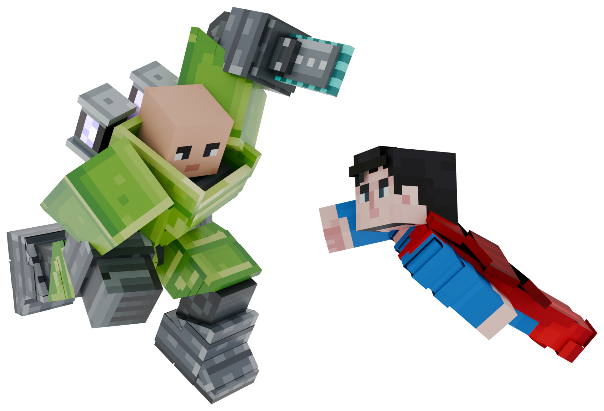
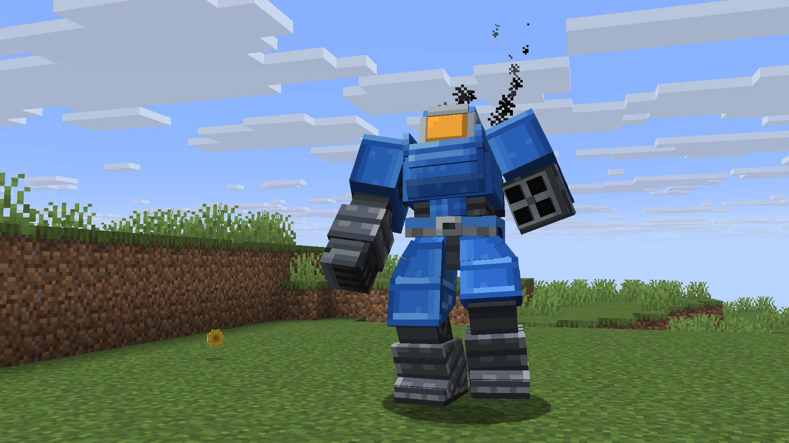
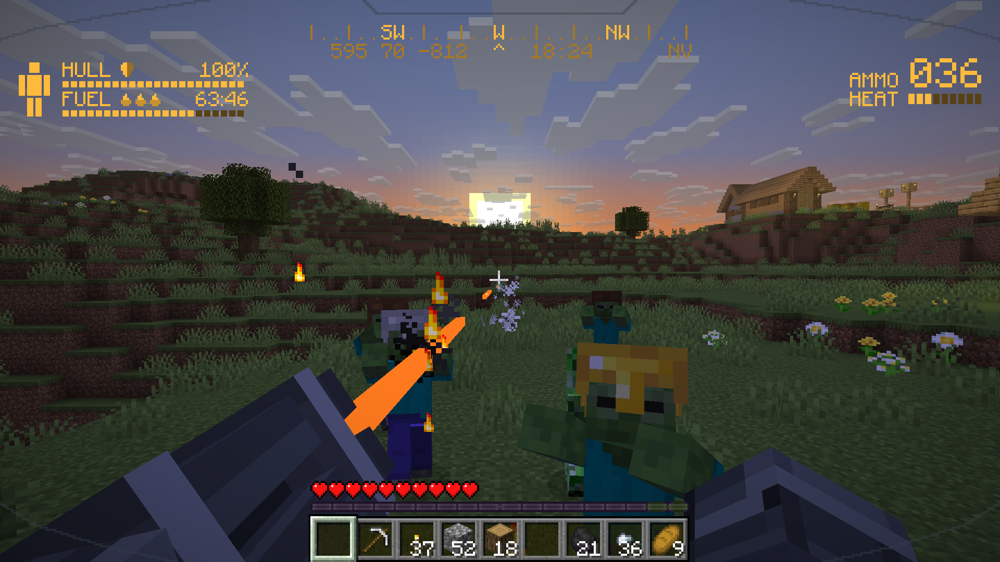
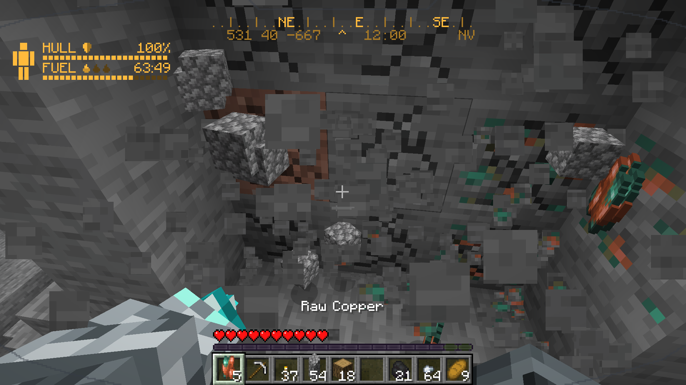
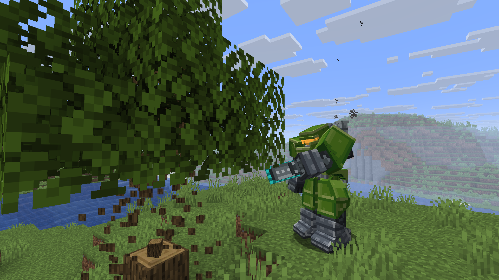
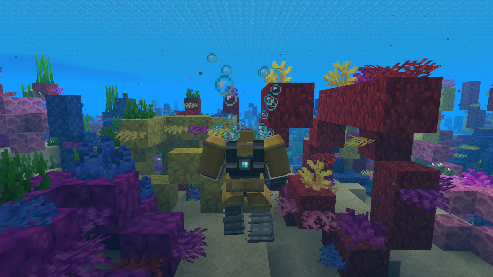
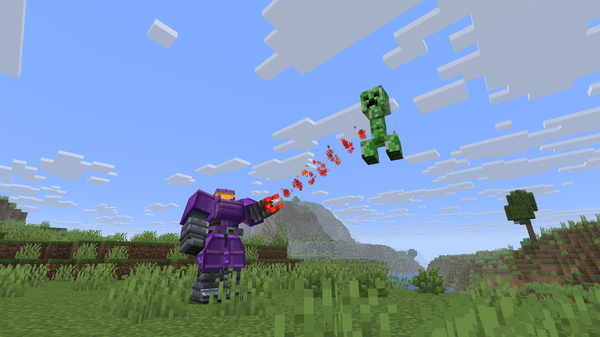

<h3 align="left">
  
  
</h3>

  
  
  
  
  

For situations where plain old armor isn't enough. This power suit provides maximum protection while also enabling access to special power tools. Inside, your inventory is the suit's: keep tools on your hotbar, swap them onto the suit's arm with F, and switch the suit off to park it with its fuel in.

When also fitted with a helmet, you become immune to fire, frost, poison and drowning. Soaking up that punishment burns fuel, so keep an eye on the visor's HUD: hull, fuel, a compass, your coordinates and a clock, in terminal green (or amber, blue, white, red, or any colour you like), and each tool brings its own readout: the TNT launcher even shows where its round will land. In the dark, the visor's night vision lifts the gloom (N switches it).

Get out of a suit and it can operate independently. It can drill, cut trees, guard your home or defend you personally. Be careful though... rogue suits exist, and they aren't friendly.

Customize your suit by dyeing it, and find the easter egg helmet templates that can be applied via a smithing table.

## Requirements
- NeoForge for Minecraft 26.3
- GeckoLib 5

## Screenshots

<table>
<tr>
<td width="50%"></td>
<td width="50%"></td>
</tr>
<tr>
<td width="50%"></td>
<td width="50%"></td>
</tr>
<tr>
<td width="50%"></td>
<td width="50%"></td>
</tr>
</table>

## More

Controls, crafting and the file map: [docs/guide.md](docs/guide.md).
